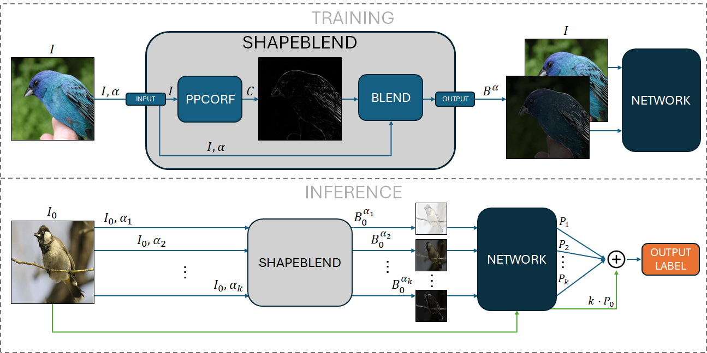

# ShapeBlend: Boosting Out-of-Distribution Robustness in Image Classification via Shape-based Blending Augmentation

Official repository for the paper:

**ShapeBlend: Boosting Out-of-Distribution Robustness in Image Classification via Shape-based Blending Augmentation**  
George Azzopardi, Sabatino Esposito, Antonio Greco, Mario Vento  
*Computer Vision and Image Understanding, 2026*  
DOI: [10.1016/j.cviu.2026.104768](https://doi.org/10.1016/j.cviu.2026.104768)

## Overview

ShapeBlend is a data augmentation method that improves out-of-distribution robustness by blending contour maps with the original images, encouraging more shape-aware representations. It can also be applied at inference time through **Shape-Enhanced Voting (SEV)**.



## Summary of Results

| Method | Evaluation | IN-C mCA ↑ | IN-C̄ mCA ↑ | IN-R Acc. ↑ | IN-A Acc. ↑ |
|---|---|---:|---:|---:|---:|
| Baseline | Standard | 39.60 | 40.63 | 36.57 | 0.78 |
| SB | Standard | 43.61 | 42.30 | 38.90 | 1.96 |
| SB | SEV_S | 46.11 | 42.89 | 40.70 | 1.74 |
| AM | Standard | 46.60 | 44.52 | 40.15 | 1.14 |
| SB + AM | Standard | 49.76 | 45.33 | 44.12 | 2.48 |
| SB + AM | SEV_S | 51.35 | 45.29 | 45.56 | 2.39 |
| PR | Standard | 52.73 | 47.43 | 40.87 | 1.47 |
| SB + PR | Standard | 54.02 | 48.29 | 44.39 | 2.34 |
| SB + PR | SEV_S | 55.14 | 48.54 | 46.21 | 2.36 |
| DA | Standard | 52.96 | 48.83 | 42.78 | 3.34 |
| SB + DA | Standard | 55.08 | 49.43 | 46.27 | 5.53 |
| SB + DA | SEV_S | 56.51 | 49.40 | 47.62 | 5.12 |
| DA + AM | Standard | 57.98 | 51.09 | 45.67 | 3.85 |
| SB + DA + AM | Standard | 59.42 | 50.85 | 49.89 | 5.49 |
| SB + DA + AM | SEV_S | 59.77 | 50.56 | **50.97** | 5.27 |
| DA + PR | Standard | 59.59 | 52.12 | 45.02 | 4.26 |
| SB + DA + PR | Standard | 60.75 | **52.76** | 49.17 | **5.65** |
| SB + DA + PR | SEV_S | **61.11** | **52.76** | 50.60 | 5.46 |

SB: ShapeBlend; AM: AugMix; DA: DeepAugment; PR: PRIME; SEV_S: Shape-Enhanced Voting (Small configuration).

Results are obtained using ResNet-50 and averaged over three runs. See the paper for the full experimental results.

## Pretrained Weights

[Download model checkpoints (Google Drive)](https://drive.google.com/drive/folders/11Ch3C26e-2PlgZ9Vvwq9inMWZwrkZpNA?usp=sharing)

## Installation

Create and activate the Conda environment:

```bash
conda env create -f environment.yml
conda activate shapeblend
```

The environment includes PyTorch with CUDA support and all
Python dependencies required for preprocessing, training,
and evaluation.

MATLAB with the Image Processing Toolbox is only required
to export the CORF geometry.

## Dataset Preparation

Download Imagenet and the OOD benchmarks required for evaluation. Place `imagenet1000/` in the repository root and organize the original images as follows:

```text
imagenet1000/
└── clean/
    ├── train/    # ImageNet training set
    ├── val/      # ImageNet validation set
    ├── valC/     # ImageNet-C
    ├── valB/     # ImageNet-C̄
    ├── valA/     # ImageNet-A
    └── valR/     # ImageNet-R
```

Each image set follows the ImageFolder class structure (e.g., `n01440764/`). For ImageNet-C and ImageNet-C̄, organize each corruption and severity as `<corruption>/<severity>/` or `<corruption><severity>/` (e.g., `gaussian_noise/1/` or `gaussian_noise1/`), followed by the class directories.

## ShapeBlend Preprocessing

To reduce training overhead across the experimental configurations, we generated contour maps and ShapeBlend variants offline. During training, one of the 18 blended variants is randomly sampled for each image, while the original images are retained in the training set.

### Contour Extraction

The GPU implementation of Push-Pull CORF uses PyTorch and a receptive field geometry exported from MATLAB.

Navigate to the preprocessing directory:

```bash
cd preprocessing
```

In MATLAB (with the Image Processing Toolbox), run the following once from this directory:

```matlab
export_corf_gpu_geometry('corf_geometry.mat', 2.2, 4);
```

Extract the contour maps using a CUDA-enabled GPU:

```bash
SPLIT=train
python corf_gpu.py \
    --geometry corf_geometry.mat \
    --input-dir ../imagenet1000/clean/$SPLIT \
    --output-dir ../imagenet1000/contours/$SPLIT \
    --inhibition-factor 1.8
```

Contour maps are saved as grayscale PNG files, preserving the directory structure.

### ShapeBlend Generation

Generate the positive and negative variants using `blend.py`. The `--alpha` argument specifies the absolute blending factor, and `--negative` selects the complement of the contour map.

```bash
for i in {1..9}; do
    python blend.py \
        --input-dir ../imagenet1000/clean/$SPLIT \
        --contours-dir ../imagenet1000/contours/$SPLIT \
        --output-dir ../imagenet1000/blend${i}/$SPLIT \
        --alpha 0.${i}

    python blend.py \
        --input-dir ../imagenet1000/clean/$SPLIT \
        --contours-dir ../imagenet1000/contours/$SPLIT \
        --output-dir ../imagenet1000/negative${i}/$SPLIT \
        --alpha 0.${i} --negative
done
```

The resulting training dataset contains `clean/train/`, `blend1/train/` through `blend9/train/`, and `negative1/train/` through `negative9/train/`. All variants preserve the original image filenames and class directories.

For SEV evaluation, repeat contour extraction and blending with `SPLIT` set to each of `val`, `valC`, `valB`, `valA`, and `valR`, using the same directory structure.

### DeepAugment (Optional)

Following DeepAugment, the EDSR and CAE outputs are generated offline. When combining DeepAugment with ShapeBlend, apply ShapeBlend first and process the resulting variants with EDSR and CAE.

Store the DeepAugment outputs under `imagenet1000/` as follows:

```text
imagenet1000/
├── EDSR/
│   ├── clean/train/
│   ├── blend1/train/ ... blend9/train/
│   └── negative1/train/ ... negative9/train/
└── CAE/
    ├── clean/train/
    ├── blend1/train/ ... blend9/train/
    └── negative1/train/ ... negative9/train/
```

The blended EDSR and CAE variants are only needed when combining ShapeBlend and DeepAugment.

## Training

The original training code is organized into two scripts: `train.py` for experiments without PRIME and `train_with_prime.py` for experiments involving PRIME.

### Network Architecture

Both scripts contain model definitions for ResNet-50 and ConvNeXt-Tiny. The active configuration is ConvNeXt-Tiny:

```python
model = convnext_tiny(weights=None)
state_dict = torch.load("weights1000/tiny.pth")
model.load_state_dict(state_dict)
```

This configuration requires the initialization file `weights1000/tiny.pth`. To use ResNet-50, comment out the entire ConvNeXt-Tiny block and uncomment the ResNet-50 definition. The commented definition loads ImageNet-pretrained weights; use `weights=None` for training from scratch.

### Training Commands

Set the learning rate to `0.1` for ResNet-50 or `0.001` for ConvNeXt-Tiny. The following example uses ResNet-50 and four GPUs:

```bash
LR=0.1
COMMON_ARGS="--nclass 1000 --epochs 30 --batch 1024 --lr $LR --wd 0.0001 --m 0.9 --num-gpus 4"
```

```bash
# Baseline
python train.py $COMMON_ARGS --exp baseline --num 1

# ShapeBlend
python train.py $COMMON_ARGS --exp SB --num 1 --online

# AugMix
python train.py $COMMON_ARGS --exp AM --num 1 --augmix
python train.py $COMMON_ARGS --exp SB_AM --num 1 --online --augmix

# PRIME
python train_with_prime.py $COMMON_ARGS --exp PR --num 1 --prime
python train_with_prime.py $COMMON_ARGS --exp SB_PR --num 1 --online --prime

# DeepAugment
python train.py $COMMON_ARGS --exp DA --num 1 --deepaugment
python train.py $COMMON_ARGS --exp SB_DA --num 1 --online --deepaugment

# DeepAugment + AugMix
python train.py $COMMON_ARGS --exp DA_AM --num 1 --deepaugment --augmix
python train.py $COMMON_ARGS --exp SB_DA_AM --num 1 --online --deepaugment --augmix

# DeepAugment + PRIME
python train_with_prime.py $COMMON_ARGS --exp DA_PR --num 1 --deepaugment --prime
python train_with_prime.py $COMMON_ARGS --exp SB_DA_PR --num 1 --online --deepaugment --prime
```

Logs and checkpoints are saved in `train/train1000/` and `train/weights1000/`. Use distinct experiment or run identifiers (`--exp`, `--num`) to avoid resuming or overwriting checkpoints from other configurations or architectures.

## Evaluation

Two scripts evaluate ImageNet, ImageNet-C, ImageNet-C̄, ImageNet-A, and ImageNet-R using the dataset structure described above.

From the repository root:

```bash
cd evaluation
```

### Standard Evaluation

```bash
python eval.py --exp SB --num 1 --arch resnet50
```

### Shape-Enhanced Voting (SEV)

Generate the corresponding ShapeBlend variants for the evaluation sets before running SEV. The three configurations are available through `--sev`:

```bash
python eval_softmax.py --exp SB --num 1 --arch resnet50 --sev small
python eval_softmax.py --exp SB --num 1 --arch resnet50 --sev medium
python eval_softmax.py --exp SB --num 1 --arch resnet50 --sev large
```

| SEV | Absolute α values | Blended images |
|---|---|---:|
| Small | 0.1, 0.4, 0.7 | 6 |
| Medium | 0.1, 0.3, 0.5, 0.7, 0.9 | 10 |
| Large | 0.1, 0.2, ..., 0.9 | 18 |

Both positive and negative variants are used. The original image is included in the voting with a weight equal to the number of blended images. Custom configurations can be specified with `--lista` and `--wc`.

Both scripts support `--arch convnext_tiny`, `--datasets` (e.g., `--datasets valC valR`), and `--checkpoint` to evaluate a specific model file. By default, the last checkpoint corresponding to `--exp` and `--num` is loaded from `train/weights1000/` and all five benchmarks are evaluated.

Each run saves a single TXT report containing the accuracy, per-corruption results, mCA and, for ImageNet-C, mCE in `evaluation/eval1000/`.

## Citation

If you find this work useful, please cite:

```bibtex
@article{azzopardi2026shapeblend,
  title={ShapeBlend: Boosting Out-of-Distribution Robustness in Image Classification via Shape-based Blending Augmentation},
  author={Azzopardi, George and Esposito, Sabatino and Greco, Antonio and Vento, Mario},
  journal={Computer Vision and Image Understanding},
  publisher={Elsevier},
  volume={268},
  pages={104768},
  year={2026},
  doi={10.1016/j.cviu.2026.104768}
}
```
