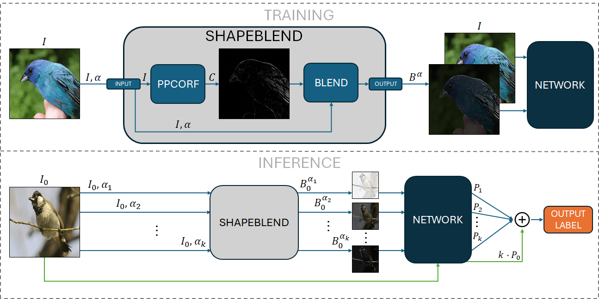

# ShapeBlend

Official repository for the paper:

**ShapeBlend: Boosting Out-of-Distribution Robustness in Image Classification via Shape-based Blending Augmentation**  
George Azzopardi, Sabatino Esposito, Antonio Greco, Mario Vento  
*Computer Vision and Image Understanding, 2026*  
DOI: [10.1016/j.cviu.2026.104768](https://doi.org/10.1016/j.cviu.2026.104768)

---

## Overview

ShapeBlend is a shape-based data augmentation strategy designed to improve out-of-distribution robustness in image classification.  
It enhances contour information by blending contour maps with the original image, encouraging more shape-aware representations.  
The method can also be used at inference time through **Shape-Enhanced Voting (SEV)**.



---

## Summary of Results

Below is a concise summary of the main results reported in the paper.

| Method | Evaluation | IN-C mCA ↑ | IN-C̄ mCA ↑ | IN-R Acc. ↑ | IN-A Acc. ↑ |
|---|---|---:|---:|---:|---:|
| Baseline | Standard | 39.60 | 40.63 | 36.57 | 0.78 |
| SB | Standard | 43.61 | 42.30 | 38.90 | 1.96 |
| SB | SEV_S | 46.11 | 42.89 | 40.70 | 1.74 |
| AM | Standard | 46.60 | 44.52 | 40.15 | 1.14 |
| SB + AM | Standard | 49.76 | 45.33 | 44.12 | 2.48 |
| SB + AM | SEV_S | 51.35 | 45.29 | 45.56 | 2.39 |
| PR | Standard | 52.73 | 47.43 | 40.87 | 1.47 |
| SB + PR | Standard | 54.02 | 48.29 | 44.39 | 2.34 |
| SB + PR | SEV_S | 55.14 | 48.54 | 46.21 | 2.36 |
| DA | Standard | 52.96 | 48.83 | 42.78 | 3.34 |
| SB + DA | Standard | 55.08 | 49.43 | 46.27 | 5.53 |
| SB + DA | SEV_S | 56.51 | 49.40 | 47.62 | 5.12 |
| DA + AM | Standard | 57.98 | 51.09 | 45.67 | 3.85 |
| SB + DA + AM | Standard | 59.42 | 50.85 | 49.89 | 5.49 |
| SB + DA + AM | SEV_S | 59.77 | 50.56 | 50.97 | 5.27 |
| DA + PR | Standard | 59.59 | 52.12 | 45.02 | 4.26 |
| SB + DA + PR | Standard | 60.75 | 52.76 | 49.17 | **5.65** |
| SB + DA + PR | SEV_S | **61.11** | **52.76** | **50.60** | 5.46 |

SB: ShapeBlend; AM: AugMix; DA: DeepAugment; PR: PRIME; SEV_S: Shape-Enhanced Voting (Small configuration). All results are reported using ResNet-50 and averaged over three runs. Higher values indicate better performance.
For full experimental details, please refer to the paper.

---

## Pretrained Weights

The pretrained weights used in our experiments are
publicly available.

📦 [Download pretrained weights (Google Drive)](https://drive.google.com/drive/folders/11Ch3C26e-2PlgZ9Vvwq9inMWZwrkZpNA?usp=sharing)

## Code

**Code: TO BE ADDED**

We are currently organizing the training and evaluation pipeline for public release.

---

## Citation

If you find this work useful, please cite:

```bibtex
@article{azzopardi2026shapeblend,
  title={ShapeBlend: Boosting out-of-distribution robustness in image classification via shape-based blending augmentation},
  author={Azzopardi, George and Esposito, Sabatino and Greco, Antonio and Vento, Mario},
  journal={Computer Vision and Image Understanding},
  publisher={Elsevier}
  volume={268},
  pages={104768},
  year={2026},
  doi={10.1016/j.cviu.2026.104768}
}
